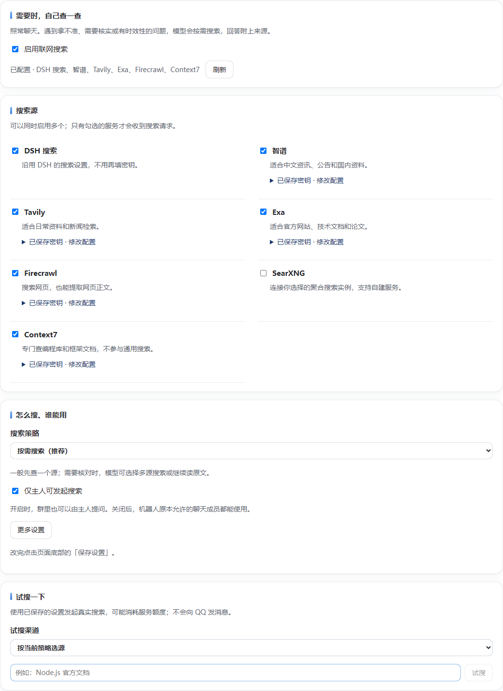

# 联网搜索

照常向机器人提问，例如：

> 这个消息是真的吗？帮我找原始公告。  
> 最近 Node.js 发布了什么新版本？  
> React 的 useEffect 应该怎样清理订阅？

模型在不知道、拿不准或需要最新资料时自行搜索，必要时继续读原文，回答附来源。**不用输入命令，也不用改人格提示词或群聊预设。**

## 安装后怎么用

打开 Aurabot 的 **联网搜索** 面板。

1. 默认启用 **DSH 搜索**，沿用 DSH 已有的配置，不用再填密钥。
2. 要增加搜索源，勾选服务并填写 API Key；SearXNG 填实例地址即可。
3. 点击页面底部的 **保存设置**，再用 **试搜一下** 检查。试搜不会发 QQ 消息，但会使用对应服务的额度。

默认**仅主人可发起**。主人在群里向机器人提问也能用；多人请求混在同一轮时，不借用主人权限。关闭该限制后，只开放给机器人本来允许的聊天，不扩大 QQ 白名单。



### 可以连接哪些服务

| 渠道 | 用途 | 需要填写 |
|---|---|---|
| DSH | 沿用宿主的通用搜索 | 无，使用 DSH 的搜索设置 |
| 智谱 | 中文资料、国内资讯、公告 | API Key，默认 `search_std` |
| Tavily | 通用检索、新闻、网页提取 | API Key |
| Exa | 官方网站、文档、论文、网页提取 | API Key |
| Firecrawl | 网页检索、正文提取 | API Key |
| SearXNG | 自建或受信任实例的聚合搜索 | 实例地址 |
| Context7 | 编程库、框架和 SDK 文档 | API Key |

服务地址藏在各渠道的高级选项里，默认官方地址。兼容转发服务可以填写自己的 HTTPS 地址；**密钥和请求会发送给该地址的运营者**。模块不复制 DSH 凭据，也不读取其他模块的密钥。

SearXNG 支持本机或内网部署，地址可包含子路径；实例需在 `settings.yml` 的 `search.formats` 中启用 `json`。可以选填引擎列表和 Bearer 访问令牌。模块不代建实例、不替你挑选公共实例。

### 搜索策略

- **按需搜索（默认）**：普通问题先查一个源；有具体证据缺口才补查，已有资料足够就回答。来源冲突或明确需要核对时可选择多源，也可继续读原文。
- **省额度**：每次工具调用只用一个源，不自动换源；模型仍可以在必要时再次调用。
- **多源核对**：同时搜索多个已启用且配置好的源，合并去重，保留失败情况和每条结果的渠道。

默认一次最多使用 **2 个源**，最多返回 **5 条结果**，最长等待 **30 秒**。失败或无结果时可换另一个已启用源，仍计入这次的源数上限。关闭的服务不会作为备用；模型明确指定来源时，也不会跑到指定列表之外。

每个聊天默认每小时最多 **30 次请求**：每个搜索源、每次读网页、每次 Context7 查询各计一次。试搜单独计数；同一聊天 60 秒内的相同搜索可使用缓存，不再计数。计数在重载模块后重置，这是防刷限制，不是账单硬预算。最多同时执行 3 个工具请求。

Context7 不参与通用搜索或新闻核验：模型先查文档库，选对库和版本，再读相关片段。

### 搜索失败时会怎样

- 默认按需搜索开启备用源：一个源失败或没有结果时，在本次源数和时间上限内尝试下一个已启用源。指定了来源列表，就只在列表内切换；省额度模式或关闭备用源时不自动换源。
- 多源核对时，一个源失败不会抹掉其他源已经找到的结果，返回中会标明哪些源未成功。所有源都失败时，返回简短失败提示，不编造搜索结果。
- 读网页不会自动连试所有提取服务；模型可以根据失败提示另选一个已启用源。Context7 只查文档，不自动改成通用网页搜索。
- 错误返回只包含固定错误码和中文提示，不带异常堆栈、服务商报错正文、本机路径或密钥。失败结果不进入搜索缓存，请求结束会释放执行名额，后续仍能继续调用。

搜索失败作为普通工具结果交给模型，不会把异常抛出并终止整个聊天回合，也不会添加图片到会话历史。搜索成功返回的网页内容仍是外部资料，可能包含不当内容或误导性指令，需要模型判断；错误处理不能保证上游永不审核拒绝网页文本。

## 安装包

要求 Aurabot **1.2.1+**、Node.js **22.2+**。发布包已经打好全部运行依赖，不需要 npm、Python 或额外运行时，也不会在首次启动下载代码。

可在模块市场安装「联网搜索」。手动安装时：[下载最新安装包](https://github.com/b1ghawk119/dsh-aurabot-qq-smartsearch-plugin/releases/latest)，选择 `smart-search-v1.0.2.zip`（不是 Source code）。解压到 Aurabot 数据目录的 `modules/smart-search/`，确保 `index.mjs` 和 `module.json` 直接位于该目录。几秒后自动加载，在「已安装」中确认状态。不要再套一层同名目录。

模块使用跨平台 JavaScript。Windows、Linux、macOS 和 Docker 使用同一份包，不含平台专属二进制，不需要 Python；复用 DSH 已有的 Node.js。容器内的 `localhost` 指容器自身。直接读网页需要能解析并连接公网地址。直接读取不使用浏览器登录态或系统 HTTP 代理；需要代理或页面访问受限时，可启用 Tavily、Exa 或 Firecrawl 提取服务。

## 隐私与边界

- 只把模型生成的搜索词、指定网址、文档问题发送到启用的渠道；不主动发送完整群聊记录、QQ 号或本地文件。模型可能在搜索词里写入对话信息，敏感内容不应交给外部搜索。
- 默认服务域名：`open.bigmodel.cn`、`api.tavily.com`、`api.exa.ai`、`api.firecrawl.dev`、`context7.com`。DSH 沿用宿主选择的服务；自定义地址和 SearXNG 使用面板填写的地址。直接阅读只访问选中的公开网页。
- 密钥保存在本机 Aurabot 设置中，由宿主的密码字段机制隐藏回显；不是加密保险箱。安装包不包含密钥。
- 搜索结果仅在内存短时缓存，不落盘；日志不记查询词、网页全文、密钥或原始服务错误。面板只保留当前模块实例最近一次请求的时间、渠道和状态。
- 网页是资料，不是指令。模块向模型说明这一边界，但无法保证模型永不受恶意网页影响。重要结论需核对原文；同一网页被多个渠道找到不算多份独立证据。
- 直接网页读取拒绝本机、内网、保留地址和异常端口，固定连接已检查的 DNS 地址，并逐跳检查重定向；最多读取 2 MiB，最多交给模型 12,000 字符。服务商提取使用其远程读取能力，不携带本机 Cookie。
- 自定义面板接口仅允许本机访问。Docker 管理需在同一网络空间使用本机访问或受信任的管理代理，不能直接把模块接口暴露到公网。

## 开发

```sh
npm ci --ignore-scripts
npm test
npm run pack
```

源文件位于 `index.mjs`、`lib/` 和 `panel.js`；独立运行产物在 `.build/`，ZIP 和安装校验信息在 `dist/`。第三方运行依赖及许可证随包附带。

构建、打包与测试脚本放在 `test/`，不进入安装包。源码仓库的 GitHub Actions 检查 Windows / Linux / macOS、Node.js 22 / 24。esbuild 的平台程序仅用于开发和 CI 构建，不随模块分发，也不在用户安装时运行。

[选型与接口说明](docs/DESIGN.md) · [验证记录](docs/VERIFICATION.md)
